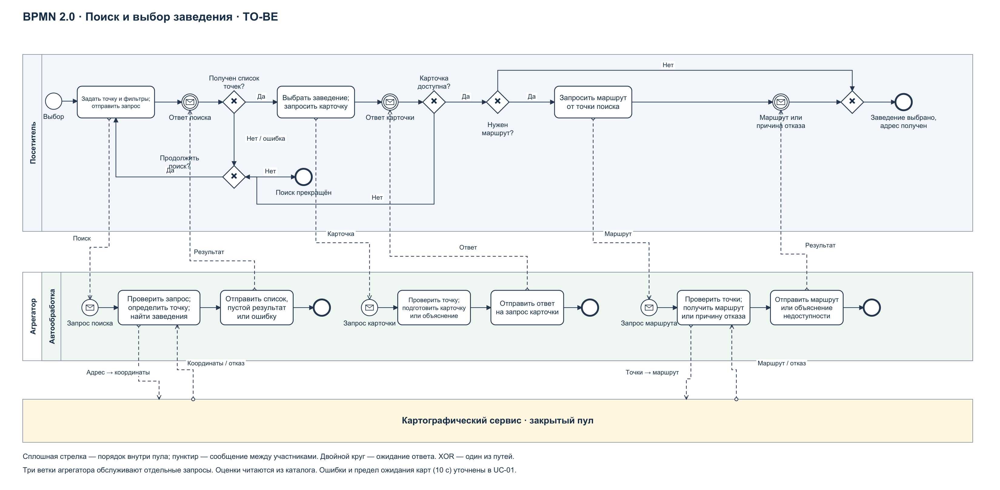
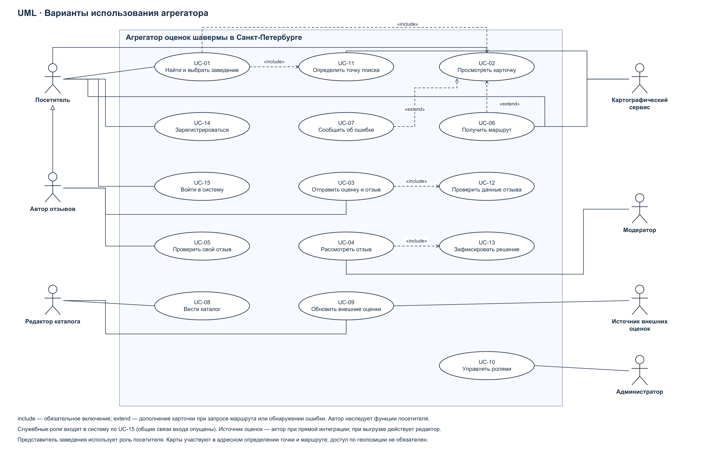

# Агрегатор оценок шавермы в Санкт-Петербурге

Спецификация требований к ПО. Итерации 1–3. Версия 1.0. 13 ноября 2026 г.

# Введение и границы проекта

## Введение

Проект посвящён подготовке спецификации требований к сервису, который помогает жителям и гостям Санкт-Петербурга находить заведения с шавермой, сравнивать оценки из разных источников и делиться собственным опытом. Проблема: сведения распределены между площадками, поэтому для выбора заведения пользователю приходится сопоставлять адреса, рейтинги и отзывы самостоятельно. Это рабочая гипотеза проекта, которую предстоит проверить интервью и пользовательским исследованием.

Комплект охватывает итерации 1–3: заинтересованные стороны и выявление требований; ключевой процесс TO-BE; варианты использования, три детальных сценария и функциональные требования. Реализация ПО, архитектура, UML-классы, последовательности и нефункциональные требования относятся к следующим итерациям.

## Основания и принятые решения

Основания: «Kursovoy_proekt.pdf», с. 2–4; «Сис анал.pdf» — пользовательский набросок первой итерации; «sec(2).drawio» — пользовательский набросок поиска и построения маршрута; «Shablon_Use_Case_SA_i_SP.docx» — форма сценариев; «Prezentatsia_proekta.pdf» — требования к итоговой упаковке. Новый PDF уже содержит методы выявления требований: ниже они уточнены до плана с целями, участниками и результатами. Интервью и опросы в рамках подготовки документов не проводились.

Процесс второй итерации сохранён по замыслу sec(2).drawio: пользователь задаёт местоположение, получает список, выбирает заведение и при необходимости получает маршрут. Вместо внутренних компонентов показаны участники бизнес-процесса и обмен результатами. Микросервисы, PostGIS, Redis, ClickHouse, REST и gRPC из наброска не считаются утверждёнными требованиями к реализации.

Численные бизнес-цели и правила ниже являются проектными предложениями для учебного пилота. Они сформулированы достаточно конкретно для проверки и подлежат согласованию с владельцем продукта. Доступность внешних данных и выбор поставщика карт не подтверждены.

## Границы пилотной версии

Включено: каталог заведений Санкт-Петербурга; поиск в радиусе от заданной точки; фильтрация по оценке выбранного источника; карточка с источниками и датами оценок; запрос маршрута; собственные оценки и текстовые отзывы; предварительная модерация; просмотр автором состояния своей публикации; сообщение об ошибке в карточке; ведение каталога и обновление внешних оценок редактором; управление служебными ролями администратором; регистрация и вход.

Минимум два внешних источника оценок необходимы для BR-01; конкретные площадки не назначены. Допустим импорт подготовленной выгрузки с подтверждённым происхождением вместо автоматического API. При таком варианте поставщик не является непосредственным актором системы, а его данные загружает редактор. На Use Case Diagram показан поставщик для варианта прямого обмена данными. В пользовательском поиске используются уже сохранённые сведения, поэтому отказ источника не блокирует просмотр каталога.

Картографический сервис участвует в определении координат по адресу и построении маршрута. При отказе геокодирования точку можно задать координатами. При отказе маршрутизации сохраняется доступ к карточке и адресу. Провайдер и способ интеграции выбираются после анализа доступности сервиса.

В пилот не включены: заказ и оплата еды, доставка, бронирование, рекламное ранжирование, фотографии пользователей, редактирование опубликованных отзывов, ответы заведений на отзывы, отдельный кабинет владельца заведения и обязательные мобильное/настольное приложения. Представитель заведения сообщает об ошибках на общих основаниях; сведения меняет редактор после проверки.

## Термины и бизнес-правила

| ID | Правило |
| --- | --- |
| RULE-01 | Заведение — конкретная точка с собственным идентификатором, названием, адресом, координатами и статусом работы. Разные филиалы сети — разные заведения. В поиске участвуют только действующие точки Санкт-Петербурга. |
| RULE-02 | Поиск выполняется по расстоянию по прямой от точки поиска. Радиус — конечное число от 0,5 до 10 км включительно. Координаты — конечные числа: широта от −90 до 90, долгота от −180 до 180. Местоположение задаётся координатами, адресом либо геопозицией с согласия пользователя. Отказ в геопозиции не запрещает поиск другими способами. |
| RULE-03 | Внешние оценки показываются раздельно: источник, оценка, исходная шкала, количество оценок, дата обновления и ссылка на первоисточник. Среднее между разными внешними площадками не рассчитывается. Неизвестное число оценок отмечается как «нет данных», а не как ноль. |
| RULE-04 | Фильтр минимального рейтинга применяется к одному выбранному источнику в его исходной шкале. Порог — конечное число в пределах шкалы выбранного источника; значение вне шкалы отклоняется. Точка без оценки этого источника исключается только при включённом фильтре. По умолчанию сортировка — расстояние по возрастанию, затем название, затем идентификатор. |
| RULE-05 | Собственная оценка — целое число от 1 до 5. Отзыв содержит от 10 до 2000 символов после удаления пробелов по краям. Публиковать могут только вошедшие в систему авторы. |
| RULE-06 | У пары «автор–заведение» допускается не более одной заявки в состоянии PENDING или PUBLISHED. После REJECTED разрешена новая заявка. Повторная отправка с тем же идентификатором запроса не создаёт новый отзыв. |
| RULE-07 | Новая корректная заявка получает PENDING и не видна публично. Модератор переводит её в PUBLISHED или REJECTED. Для REJECTED обязательна причина. Отклоняются спам, оскорбления, раскрытие чужих личных сведений и содержание, не относящееся к посещению заведения. Правила применяет человек, автоматическое распознавание не предполагается. |
| RULE-08 | Собственный рейтинг точки — среднее арифметическое оценок PUBLISHED, округлённое до одного десятичного знака по правилу half-up. При отсутствии таких оценок показано «нет оценок». PENDING и REJECTED на рейтинг не влияют. Внешние оценки хранятся отдельно. |
| RULE-09 | Решение модератора, состояние отзыва и изменение собственного рейтинга фиксируются согласованно: при ошибке ни одно из изменений не подтверждается. Решение содержит идентификаторы отзыва и модератора, результат, причину при отклонении и время. Повторное решение по уже рассмотренной заявке не меняет результат. |
| RULE-10 | Результат модерации доступен автору в состоянии заявки внутри сервиса. Email, SMS и push для пилота не требуются. Техническая ошибка не выдаётся за успешную публикацию или за отсутствие заведений. |

## Связь идентификаторов с набросками

Сохранены ID из business_requirements.md и stakeholders.md: на них опираются перекрёстные ссылки. В «Сис анал.pdf» применена другая нумерация; соответствие приведено ниже, чтобы не менять смысл существующих ID.

| В новом PDF | В этом комплекте | Содержание |
| --- | --- | --- |
| BR-01 | BR-01 | Два источника для 50 заведений |
| BR-02 | BR-02 | Снижение времени выбора |
| BR-03 | BR-04 | Собственные оценки |
| BR-04 | BR-06 | Аудитория шестого месяца, резерв развития |
| ST-IN-01 / 02 / 03 | ST-01 / 02 / 03 | Владелец, аналитик, разработчик |
| ST-IN-04 / 05 / 06 | ST-09 / 07 / 06 | Поддержка, модератор, администратор |
| ST-OUT-01 / 02 / 03 / 04 | ST-11 / 12 / 13 / 14 | Посетители, авторы, представители и сотрудники заведений |
| ST-OUT-05 / 06 / 07 / 08 | ST-18 / 17 / 16 / 15 | Регулятор, инфраструктура, карты и источники оценок |

Исходная карта дополнительно содержит дизайнера, тестировщика, редактора каталога, специалиста по развитию и преподавателя. Эти роли сохранены: они участвуют в проекте, даже если не имеют отдельных учётных записей продукта.

# Итерация 1. Стейкхолдеры и выявление требований

## Карта стейкхолдеров

**Внутренние стейкхолдеры** — участники команды, которая создаёт, развивает и обслуживает агрегатор. **Внешние стейкхолдеры** — пользователи, представители заведений, сторонние организации и другие лица вне этой команды, которые взаимодействуют с продуктом или затронуты его работой.

Это перечень ролей, а не отдельных штатных должностей. В учебной команде из 1–3 человек один участник может совмещать несколько внутренних ролей. Условные стейкхолдеры участвуют только при появлении соответствующей функции или способа размещения сервиса.

| ID | Тип | Стейкхолдер | Роль | Влияние | Интерес |
| --- | --- | --- | --- | --- | --- |
| ST-01 | Внутренний | Инициатор и владелец продукта | Заказчик | Высокое | Высокий |
| ST-02 | Внутренний | Системный / бизнес-аналитик | Специалист по требованиям | Высокое | Высокий |
| ST-03 | Внутренний | Разработчик | Технический специалист | Высокое | Высокий |
| ST-04 | Внутренний | Дизайнер интерфейса | UX/UI-специалист | Среднее | Высокий |
| ST-05 | Внутренний | Тестировщик | Специалист по качеству | Среднее | Высокий |
| ST-06 | Внутренний | Администратор сервиса | Технический администратор | Высокое | Высокий |
| ST-07 | Внутренний | Модератор | Специалист по пользовательскому контенту | Среднее | Высокий |
| ST-08 | Внутренний | Редактор каталога заведений | Контент-менеджер | Среднее | Высокий |
| ST-09 | Внутренний | Специалист поддержки | Сотрудник по работе с обращениями | Среднее | Высокий |
| ST-10 | Внутренний | Специалист по развитию продукта | Маркетолог / продуктовый аналитик | Среднее | Высокий |
| ST-11 | Внешний | Посетители сервиса: жители и гости Санкт-Петербурга | Пользователи поиска и рейтингов | Низкое | Высокий |
| ST-12 | Внешний | Авторы оценок и отзывов | Пользователи, создающие контент | Среднее | Высокий |
| ST-13 | Внешний | Владельцы и уполномоченные представители заведений | Представители бизнеса | Среднее | Высокий |
| ST-14 | Внешний | Сотрудники заведений | Косвенно затронутые участники | Низкое | Средний |
| ST-15 | Внешний | Организации — владельцы внешних площадок с оценками и отзывами | Поставщики данных / партнёры по интеграции | Высокое | Средний |
| ST-16 | Внешний | Поставщик картографического и геокодирующего сервиса | Технический партнёр | Среднее | Средний |
| ST-17 | Внешний, условный | Поставщик хостинга или облачной инфраструктуры | Поставщик инфраструктуры | Среднее | Средний |
| ST-18 | Внешний | Уполномоченные контролирующие органы | Регулятор | Высокое | Низкий |
| ST-19 | Внешний | Преподаватель / комиссия по защите курсовой | Эксперт и принимающая сторона учебного проекта | Высокое | Высокий |

- **Влияние** — возможность определять цели, требования и приоритеты, влиять на приёмку или доступность продукта. Высокое означает определяющую роль; среднее — влияние на отдельные функции, данные или качество; низкое — преимущественно обратную связь и косвенное воздействие.
- **Интерес** — степень заинтересованности в результате и качестве работы агрегатора. Высокий означает непосредственную пользу или ответственность за результат; средний — участие в отдельных процессах; низкий — эпизодическое взаимодействие.

Оценки предварительные и основаны на принятом видении продукта. Для посетителей указан уровень влияния отдельного пользователя; совокупная обратная связь аудитории может существенно менять приоритеты проекта.

Представители заведений заинтересованы в своей репутации, поэтому правила расчёта рейтинга и модерации согласуются владельцем продукта с учётом интересов читателей и авторов отзывов. Предоставление сведений о заведении само по себе не даёт его представителю права изменять пользовательские оценки.

## План выявления требований

### Методы, участники и ожидаемые результаты

План уточняет методы из «Сис анал.pdf» и покрывает все 19 ролей карты стейкхолдеров. Указанные объёмы и сроки — план работы, а не сведения о проведённых исследованиях. При совмещении ролей один человек может участвовать в нескольких обсуждениях.

| ID сторон | Метод и участники | Цель сбора информации | Ожидаемый артефакт |
| --- | --- | --- | --- |
| ST-01: владелец продукта | Интервью 45–60 минут и рабочая встреча | Уточнить проблему, три основные бизнес-цели, границы пилота и критерии приёмки | Согласованное видение, список приоритетов и допущений |
| ST-02: аналитик | Анализ задания и совместный разбор требований | Устранить противоречия, определить словарь и связи целей со сценариями | Глоссарий, реестр требований и открытых вопросов |
| ST-03: разработчик | Техническая рабочая встреча и пробный импорт небольшой выборки | Проверить поиск по расстоянию, доступность источников и реализуемость обработки отзывов | Список ограничений, результат пробы импорта |
| ST-04: дизайнер | Совместный разбор пути пользователя и проверка бумажного прототипа | Определить понятный способ сравнения источников, задания точки и понимания статуса отзыва | Замечания к сценарию и прототипу |
| ST-05: тестировщик | Ревью требований и таблиц решений | Проверить однозначность правил, границы значений и наблюдаемость результата | Приёмочные примеры для FR и перечень противоречий |
| ST-06: администратор | Интервью и разбор эксплуатационных ситуаций | Определить служебные роли, ограничения доступа и восстановление после ошибок | Матрица ролей; вопросы для NFR следующей итерации |
| ST-07: модератор | Интервью 45 минут и разбор 10 примеров отзывов | Уточнить основания отклонения, конкурирующие решения и статус для автора | Таблица правил модерации и переходов состояний |
| ST-08: редактор каталога | Наблюдение за разбором 10 карточек и рабочая встреча | Определить обязательные поля, признаки дубля, порядок исправления и импорта | Шаблон карточки, правила проверки источника |
| ST-09: поддержка | Интервью и классификация доступных обращений | Уточнить типовые ошибки, жалобы и передачу исправлений редактору | Категории обращений и сценарий передачи; при отсутствии журнала — модельные ситуации |
| ST-10: развитие продукта | Рабочая встреча и анализ плана пользовательского исследования | Определить измерение времени выбора и учёт собственных оценок | План измерения BR-02 и BR-04 |
| ST-11: посетители | 5–7 интервью по 20 минут и онлайн-опрос не менее 30 человек | Выяснить текущий выбор заведения, важные фильтры, понимание источников и маршрут | Список пользовательских потребностей и сводка ответов |
| ST-12: авторы отзывов | 3–5 интервью с авторами и разбор сценария публикации | Уточнить мотивацию, обязательные данные и понимание модерации | Уточнения UC-03, UC-04 и RULE-05–10 |
| ST-13: представители заведений | 2–3 интервью | Определить порядок подтверждения адреса и исправления карточки; исключить изменение чужих оценок | Правила обращения и разграничения полномочий |
| ST-14: сотрудники заведений | 2–3 коротких интервью и наблюдение с согласия участников | Уточнить, какие сведения о точке важны для посетителя | Уточнения полей карточки без отдельного кабинета сотрудника |
| ST-15: внешние площадки | Анализ условий предоставления данных и документации двух кандидатов; при возможности — запрос разъяснений | Проверить доступность оценок, шкал, числа голосов, дат и ссылок; сравнить API и выгрузку | Матрица источников и решение по способу получения данных |
| ST-16: карты | Анализ документации кандидата и проба адресов/маршрутов | Проверить геокодирование, маршрутизацию, отказы и возможность ручных координат | Таблица возможностей и ограничений; выбранный способ интеграции |
| ST-17: инфраструктура | Анализ технических условий и консультация | Уточнить размещение и эксплуатационные ограничения | Список ограничений для архитектуры и NFR |
| ST-18: регулятор | Анализ применимых официальных документов; при необходимости экспертная консультация | Выявить ограничения работы с учётными записями и пользовательским контентом | Реестр применимых ограничений с первоисточниками; это запланированная работа, не юридическое заключение |
| ST-19: преподаватель | Ревью комплекта по заданию | Подтвердить полноту артефактов и корректность нотаций | Список замечаний к итерациям и отметки об исправлении |

### Последовательность работ

| Период от начала выявления | Действия | Ответственный | Условие завершения |
| --- | --- | --- | --- |
| Дни 1–2 | Интервью с владельцем; анализ исходников; проверка двух источников оценок и карт | Аналитик и разработчик | Зафиксированы границы, доступные данные и риски |
| Дни 3–5 | Интервью посетителей, авторов, представителей заведений; запуск опроса | Аналитик | Подготовлена сводка потребностей без выдуманных результатов |
| Дни 6–7 | Разбор модерации, каталога и обращений; обсуждение служебных ролей | Аналитик и участники соответствующих ролей | Уточнены правила, исключения и права |
| Дни 8–9 | Ревью BPMN, UC и FR; приёмочные примеры | Аналитик, разработчик, тестировщик | Для каждого ключевого сценария определены успешный исход и ошибки |
| День 10 | Согласование с владельцем и проверка по заданию | Владелец продукта и аналитик | Сохранена версия требований и список оставшихся допущений |

### Вопросы для интервью

Посетитель: как вы выбирали шаверму в последний раз; сколько площадок открывали; что заставило отказаться от точки; нужен ли радиус поиска; каким источникам доверяете; что делаете при разных оценках; нужен ли маршрут?

Автор: что мотивирует оставить отзыв; какая оценка и пояснение достаточны; как вы ожидаете узнать решение модератора; что делать после отклонения?

Модератор: по каким наблюдаемым признакам отклонять отзыв; когда нужна причина; как действовать, если заявку уже рассмотрел коллега; что должен видеть автор?

Владелец продукта: какие три цели важнее; можно ли начать с выгрузок; что делать, если два источника недоступны; какие изменения требуют повторного согласования?

### Фиксация и согласование

Каждой выявленной потребности назначаются ID, источник и дата; реальные ответы отделяются от предположений команды. Конфликты фиксируются в реестре вопросов, обсуждаются аналитиком с затронутыми ролями и разрешаются владельцем продукта. Изменения получают ссылку на затронутые BR, RULE, UC и FR. Статус текущего комплекта — проект для согласования, а не результат проведённых интервью.

## Предварительное видение: три ключевых SMART-требования

Сроки отсчитываются от запуска пилота. Это целевые показатели учебного проекта, а не результаты исследования рынка. Сохранены исходные ID; выбранные BR-01, BR-02 и BR-04 соответствуют BR-01, BR-02 и BR-03 документа «Сис анал.pdf».

| ID | Бизнес-требование | Бизнес-ценность | Как проверить достижение |
| --- | --- | --- | --- |
| BR-01 | **Создать единое пространство для сравнения заведений:** к запуску пилотной версии объединить в одном каталоге оценки как минимум из двух источников для не менее 50 заведений с шавермой в Санкт-Петербурге. | Посетители получают сведения для сравнения заведений в одном месте и реже обращаются к нескольким площадкам. | Проверить каталог: в нём есть минимум 50 уникальных заведений Санкт-Петербурга, для каждого представлены оценки минимум из двух источников с указанием их происхождения. |
| BR-02 | **Сократить время выбора заведения:** в течение первого месяца после запуска добиться уменьшения медианного времени выбора подходящего заведения минимум на 30% по сравнению с самостоятельным поиском по нескольким площадкам. | Жители и гости города быстрее принимают решение, где купить шаверму. | Провести сравнительное исследование с участием не менее 30 представителей целевой аудитории. Использовать сопоставимые задания и менять порядок способов поиска между участниками. Сравнить медианное время от получения задания до выбора заведения; снижение должно составить не менее 30%. |
| BR-04 | **Сформировать собственную базу пользовательского опыта:** за первые три месяца после запуска получить не менее 100 опубликованных оценок заведений от минимум 30 разных пользователей агрегатора. | Продукт накапливает собственные данные и дополняет сведения внешних источников опытом своей аудитории. | Подсчитать опубликованные собственные оценки и их авторов. Не учитывать импортированные оценки, тестовые аккаунты и удалённые публикации; повторную оценку тем же автором того же заведения считать одной оценкой. |

В BR-01 к запуску должны быть доступны не менее 50 уникальных точек с оценками двух внешних источников. Если источник недоступен, цель пересматривается до запуска. Приёмка учитывает происхождение данных; выдуманные оценки не заменяют внешний источник.

Для BR-02 используются сопоставимые задания и меняется порядок способов поиска между участниками. Снижение времени рассчитывается: (медиана самостоятельного поиска − медиана выбора через агрегатор) / медиана самостоятельного поиска × 100%. Исходное время определяется в исследовании.

В BR-04 учитываются только опубликованные собственные оценки реальных участников: импортированные записи, тестовые аккаунты и удалённые публикации исключаются. Одна пара «автор–заведение» даёт не более одной опубликованной оценки.

Остальные цели исходного business_requirements.md сохранены как резерв развития: BR-03 — доверие аудитории, BR-05 — актуальность каталога, BR-06 — аудитория шестого месяца. Для текущей сдачи выбраны ровно три цели. Реальные опросы и показатели пока не получены.

# Итерация 2. Ключевой бизнес-процесс TO-BE

## Поиск и выбор заведения с получением маршрута

Цель процесса — помочь посетителю выбрать действующую точку с шавермой рядом с заданным местоположением на основе сопоставимых сведений об оценках. Начало: возникла потребность выбрать заведение. Успешное завершение: заведение выбрано, адрес получен; при запросе маршрута получен маршрут либо объяснение его недоступности. Альтернативное завершение: пользователь прекратил поиск, когда подходящих точек нет.

Процесс основан на пользовательском файле sec(2).drawio. Исходник сохранён в корне без изменений. Уточнённая модель находится в diagrams/02_search_process.drawio и diagrams/02_search_process.bpmn; PDF и PNG с тем же именем предназначены для просмотра.

## Участники и границы

| Участник | Ответственность |
| --- | --- |
| Посетитель | Задаёт точку и фильтры, принимает результат, уточняет запрос или выбирает заведение, при необходимости запрашивает маршрут |
| Агрегатор | Проверяет запрос, определяет координаты, ищет точки, возвращает оценки и карточку, организует получение маршрута |
| Картографический сервис | Определяет координаты по адресу и рассчитывает маршрут; показан закрытым пулом, внутренние процессы провайдера не моделируются |

Каждый запрос поиска, карточки или маршрута обслуживается отдельным экземпляром соответствующей ветки процесса агрегатора. В модели три стартовых события-сообщения; это не три последовательных этапа одного серверного экземпляра. Посетитель координирует сквозной процесс. Сообщения соотносятся по идентификатору запроса и выбранного заведения; технический протокол не задаётся.

## Ход процесса

1. Посетитель задаёт местоположение и фильтры, затем передаёт запрос агрегатору.
2. Агрегатор проверяет радиус и параметры, определяет точку поиска; при адресном вводе обращается к картографическому сервису. При ошибке возвращает объяснение и запрос исправления. Корректный запрос обрабатывается по RULE-01–04.
3. Агрегатор отправляет результат: найденные точки с расстояниями и доступными внешними оценками либо явное отсутствие результатов. Технические ошибки возвращаются отдельно от пустой выдачи.
4. Посетитель ожидает ответ в промежуточном событии-сообщении. Если результатов нет или требуется исправление, он уточняет запрос и повторяет поиск либо завершает его.
5. При наличии подходящей точки посетитель выбирает её и запрашивает карточку. Агрегатор возвращает адрес, статус и оценки с происхождением. Если точка перестала быть доступной, посетитель возвращается к поиску.
6. Посетитель может закончить выбор, получив адрес. Если нужен маршрут, он передаёт отдельный запрос. Агрегатор проверяет координаты, обращается к картографическому сервису и возвращает маршрут либо причину недоступности. Ожидание ответа посетителем показано промежуточным событием.
7. После получения результата маршрута процесс завершается выбором заведения; недоступность маршрута не аннулирует выбранную карточку и адрес.

## Нотация и уточнения модели

Использованы отдельные пулы посетителя, агрегатора и поставщика карт. Внутри пула агрегатора находится дорожка автоматической обработки «Автообработка». Сплошные потоки последовательности соединяют элементы только внутри одного пула. Пунктирные потоки сообщений соединяют участников. XOR-шлюзы имеют подписанные альтернативы; ожидание результатов показано двойным кругом с конвертом, а стартовые события агрегатора — кругом с конвертом. Роль исполнителя задачи определяется пулом; в BPMN-исходнике дополнительно указаны типы пользовательских и автоматических задач.

Бизнес-процесс не описывает REST-вызовы, кэши и отдельные микросервисы. Источники оценок обновляются отдельной функцией каталога (UC-09); поиск читает уже сохранённые оценки. Это устраняет зависимость каждого пользовательского поиска от одновременной доступности нескольких площадок.

Для читаемости автоматическая обработка ошибок поиска и карточки свёрнута в задачу формирования ответа: успешный результат, отсутствие данных и ошибка различаются содержимым сообщения. Подробные реакции приведены в UC-01 и FR-01–17. Геокодирование и маршрутизация выполняются с конечным ожиданием: при отсутствии ответа в течение 10 секунд агрегатор формирует ответ о недоступности, поэтому посетитель не остаётся в бесконечном ожидании. Этот предел — согласуемое правило пилота.

## Соответствие модели сценариям

| Элемент процесса | Сценарий | Требования |
| --- | --- | --- |
| Отправить запрос; определить точку и найти точки | UC-01, шаги 1–4 | FR-01–08 |
| Получить результат; уточнить или прекратить поиск | UC-01, альтернативы 2.a, 3.a, 4.a | FR-03, FR-09, FR-15–17 |
| Выбрать заведение и получить карточку | UC-01, шаги 5–6; UC-02 | FR-10–12 |
| Запросить и получить маршрут | UC-01, альтернатива 6.a; UC-06 | FR-13–14, FR-17 |

# Итерация 3. Функциональные требования и сценарии

## Акторы и варианты использования

Актор — роль, непосредственно взаимодействующая с агрегатором. Это не полный список заинтересованных сторон: преподаватель, сотрудники заведений, аналитик, хостинг и разработчик заинтересованы в проекте, но отдельные пользовательские функции для них не вводятся.

| Актор | Связь со стейкхолдерами | Доступные цели |
| --- | --- | --- |
| Посетитель | ST-11 | Поиск, карточка, маршрут, сообщение об ошибке, регистрация и вход |
| Автор отзывов | ST-12; специализация посетителя | Отправка собственного отзыва и просмотр его состояния; функции посетителя наследуются |
| Модератор | ST-07 | Рассмотрение заявок и фиксация решений |
| Редактор каталога | ST-08 | Ведение карточек и обновление внешних оценок |
| Администратор | ST-06 | Назначение служебных ролей |
| Картографический сервис | ST-16 | Определение координат по адресу и расчёт маршрута |
| Источник внешних оценок | ST-15 | Передача внешних оценок при прямой интеграции |

Представитель заведения (ST-13) пользуется ролью посетителя, чтобы сообщить об ошибке. Поддержка (ST-09) передаёт обращения редактору или модератору; отдельный модуль поддержки в границы пилота не включён. Владелец продукта согласует правила вне пользовательского интерфейса.

| ID | Вариант использования | Основной участник | Результат |
| --- | --- | --- | --- |
| UC-01 | Найти и выбрать заведение | Посетитель | Выбрана точка и получена её карточка |
| UC-02 | Просмотреть карточку заведения | Посетитель | Получены адрес, статус, оценки источников и опубликованные отзывы |
| UC-03 | Отправить оценку и отзыв | Автор | Создана заявка PENDING, выдан её идентификатор |
| UC-04 | Рассмотреть отзыв | Модератор | Заявка опубликована либо отклонена с причиной |
| UC-05 | Проверить состояние своего отзыва | Автор | Получены собственные заявки, их состояния и причины отклонения |
| UC-06 | Получить маршрут | Посетитель; карты | Получен маршрут к выбранной точке либо причина недоступности |
| UC-07 | Сообщить об ошибке карточки | Посетитель | Зарегистрировано обращение с идентификатором точки и описанием |
| UC-08 | Вести каталог заведений | Редактор | Карточка добавлена или исправлена после проверки сведений |
| UC-09 | Обновить внешние оценки | Редактор; источник | Сохранена проверенная выгрузка или ответ источника с датой и происхождением |
| UC-10 | Управлять служебными ролями | Администратор | Назначены или отозваны роли модератора и редактора |
| UC-11 | Определить точку поиска | Посетитель; карты | Получены координаты из ручного ввода, геопозиции или адреса |
| UC-12 | Проверить данные отзыва | Включаемый сценарий UC-03 | Проверены оценка, длина, существование точки и допустимость повторной заявки |
| UC-13 | Зафиксировать решение модерации | Включаемый сценарий UC-04 | Согласованно сохранены решение, состояние и собственный рейтинг |
| UC-14 | Зарегистрироваться | Посетитель | Создана личная учётная запись |
| UC-15 | Войти в систему | Посетитель и сотрудники | Установлена личность и применены назначенные права |

## Семантика связей UML

UC-01 включает (include) UC-11 и UC-02: успешный выбор требует определения точки и получения карточки. UC-03 включает UC-12; UC-04 включает UC-13. Стрелка include направлена от основного варианта к включаемому.

UC-06 расширяет (extend) UC-02 в точке «карточка получена» при условии, что посетитель запросил маршрут. UC-07 расширяет UC-02 в той же точке при обнаружении неточности. Стрелка extend направлена от дополнительного варианта к расширяемому. Маршрут и обращение не обязательны для просмотра карточки. Эти отношения не изображают хронологический порядок вызовов.

## UC-01. Найти и выбрать заведение

Описание: сократить самостоятельное сопоставление нескольких площадок, помогая выбрать действующую точку в заданном радиусе. Связанные цели: BR-01, BR-02. Приоритет: высокий.

Акторы: посетитель; картографический сервис при адресном вводе или запросе маршрута. Триггер: посетитель хочет найти шаверму рядом с заданной точкой.

Предусловия: каталог доступен; посетителю разрешён анонимный просмотр. Наличие геопозиции и вход в учётную запись не требуются. Наличие подходящих точек не является предусловием.

| Шаг | Действие |
| --- | --- |
| 1 | Посетитель задаёт точку поиска координатами и радиус; при необходимости указывает источник и минимальную оценку. |
| 2 | Система проверяет значения и определяет точку поиска по RULE-02. |
| 3 | Система отбирает действующие заведения Санкт-Петербурга в пределах радиуса и применяет фильтр по RULE-04. |
| 4 | Система предоставляет список, упорядоченный по расстоянию, с названиями, адресами, расстояниями и доступными оценками источников. |
| 5 | Посетитель выбирает заведение и запрашивает сведения о нём. |
| 6 | Система проверяет доступность точки и предоставляет карточку: адрес, статус, координаты, внешние оценки с происхождением, собственный рейтинг и опубликованные отзывы. |
| 7 | Посетитель получает сведения и завершает выбор заведения. |

Альтернативные сценарии:

| Номер | Условие и действия |
| --- | --- |
| 1.a.1 | Вместо координат посетитель задаёт адрес; система запрашивает координаты у картографического сервиса. При однозначном ответе продолжение с шага 2. |
| 1.b.1 | Посетитель разрешает получение геопозиции; система использует полученные координаты и продолжает шаг 2. При отказе или отсутствии координат предлагает ручной ввод; продолжение с шага 1. |
| 2.a.1 | Значение радиуса или фильтра недопустимо: система указывает ошибочное поле и допустимый диапазон. Посетитель исправляет параметры; возврат к шагу 1. |
| 2.b.1 | Адрес не найден или неоднозначен: система сообщает об этом; посетитель уточняет адрес или задаёт координаты; возврат к шагу 1. |
| 3.a.1 | Найденных точек нет: система сообщает об отсутствии результатов по запросу. Посетитель меняет точку, радиус или фильтр; возврат к шагу 1. При отказе продолжать сценарий завершается без выбора. |
| 4.a.1 | Посетитель уточняет критерии, не выбирая точку; возврат к шагу 1. |
| 6.a.1 | После получения карточки посетитель запрашивает маршрут. Система передаёт исходную точку и координаты заведения картографическому сервису. |
| 6.a.2 | Система предоставляет полученный маршрут; продолжение с шага 7. Если маршрут не найден, система сообщает об этом и сохраняет доступ к адресу; продолжение с шага 7 без маршрута. |
| 6.b.1 | Карточка удалена либо точка закрылась после выдачи: система сообщает об изменении; посетитель возвращается к поиску с прежними параметрами, шаг 3. |
| 6.c.1 | В карточке нет собственных оценок либо отсутствуют сведения одного источника: система явно отмечает отсутствие соответствующих данных и показывает остальные; продолжение с шага 7. |
| 6.d.1 | Посетитель сообщает об ошибке карточки (UC-07); система сохраняет обращение с описанием и возвращает его ID. Возврат к шагу 6. |

Ошибки и отсутствие данных:

| Код | Ситуация | Реакция системы |
| --- | --- | --- |
| E1 | Недопустимые координаты или пустое местоположение | Запрос не выполняется; указаны допустимые координаты и необходимость задания точки. Возврат к шагу 1. |
| E2 | Картографический сервис недоступен или не ответил за 10 секунд при геокодировании | Указана недоступность определения адреса; предложены координаты. Возврат к шагу 1. |
| E3 | Каталог недоступен при поиске или получении карточки | Выдана техническая ошибка и возможность повторить запрос с теми же параметрами; пустая выдача не имитируется. Успешный выбор не фиксируется. |
| E4 | Ошибка или ожидание более 10 секунд при построении маршрута | Указана недоступность маршрута; адрес и карточка сохраняются. Продолжение с шага 7. |

Постусловия успеха: карточка выбранного заведения предоставлена; при успешном дополнительном запросе маршрут предоставлен. Данные каталога не изменены. При прекращении поиска выбор не выполнен; при ошибке технический результат не представлен как успешный.

## UC-03. Отправить оценку и отзыв

Описание: получить собственный пользовательский опыт для каталога без немедленной публикации непроверенного содержания. Связанные цели: BR-04 и доверие к сведениям. Приоритет: высокий.

Акторы: автор отзывов. Триггер: автор хочет оценить посещённое заведение.

Предусловия: автор вошёл в систему; идентификатор заведения известен. Допустимость точки и наличие предыдущей заявки проверяются внутри сценария, а не предполагаются.

| Шаг | Действие |
| --- | --- |
| 1 | Автор передаёт идентификатор заведения, целую оценку от 1 до 5 и текст отзыва. Каждой попытке назначен идентификатор запроса. |
| 2 | Система проверяет личность автора и наличие действующей точки в каталоге. |
| 3 | Система проверяет оценку, длину текста и отсутствие другой заявки PENDING или PUBLISHED для той же пары «автор–заведение». |
| 4 | Система сохраняет новую заявку с автором, точкой, оценкой, текстом, временем и состоянием PENDING; заявка включена в очередь модерации. |
| 5 | Система сообщает автору идентификатор заявки, состояние PENDING и необходимость модерации. |
| 6 | Автор получает подтверждение приёма. |

Альтернативные сценарии:

| Номер | Условие и действия |
| --- | --- |
| 2.a.1 | Сеанс истёк: система требует повторного входа. После успешного входа автор повторно отправляет данные; возврат к шагу 1. Без входа заявка не создаётся. |
| 2.b.1 | Точка удалена или не действует: система отказывает в приёме; сценарий завершён без новой заявки. |
| 3.a.1 | Оценка или текст не соответствуют RULE-05: система указывает конкретные нарушения. Автор исправляет данные; возврат к шагу 1. |
| 3.b.1 | Уже есть PENDING или PUBLISHED: система отказывает в создании второй заявки и предоставляет ID и состояние существующей собственной заявки. Сценарий завершён без новой заявки. |
| 3.c.1 | Предыдущая заявка отклонена: при соблюдении остальных правил система принимает новую заявку; продолжение с шага 4. Старая заявка сохраняется в истории. |
| 4.a.1 | Повторён уже выполненный запрос с тем же идентификатором и теми же данными: система возвращает результат первой обработки без создания новой заявки. Переход к шагу 5. |
| 4.b.1 | Две попытки одного автора поступили одновременно с разными идентификаторами: сохраняется одна активная заявка, другая обрабатывается по 3.b.1. |

Ошибки:

| Код | Ситуация | Реакция системы |
| --- | --- | --- |
| E1 | Ошибка сохранения | Новая заявка не подтверждается; выдана техническая ошибка и возможность повтора с тем же идентификатором. Публичный рейтинг не меняется. |
| E2 | Подтверждение потерялось после сохранения | Автор может повторить запрос с тем же идентификатором или проверить свои заявки (UC-05). Повтор не создаёт дубликат. |
| E3 | Для уже обработанного идентификатора переданы другие данные | Система сообщает о конфликте идентификатора; данные ранее принятой заявки не изменяются. Для новой попытки нужен новый идентификатор. |

Постусловия успеха: ровно одна новая заявка сохранена в PENDING, доступна автору и модератору; в публичной карточке отсутствует и в собственном рейтинге не учтена. При ошибке новые данные не подтверждены; повтор ранее успешного запроса возвращает прежнюю заявку.

## UC-04. Рассмотреть отзыв

Описание: опубликовать допустимый отзыв или обоснованно отклонить его, сохранив согласованность собственного рейтинга. Связанная цель: BR-04. Приоритет: высокий.

Акторы: модератор; автор как получатель результата через UC-05. Триггер: модератор обращается к очереди PENDING.

Предусловия: модератор вошёл в систему и имеет действующую служебную роль. Наличие заявок не является предусловием.

| Шаг | Действие |
| --- | --- |
| 1 | Модератор запрашивает очередь ожидающих рассмотрения заявок. |
| 2 | Система возвращает заявки PENDING; модератор выбирает одну. |
| 3 | Система предоставляет текст, оценку, заведение, автора, время и текущее состояние заявки. |
| 4 | Модератор проверяет содержание по RULE-07 и передаёт решение PUBLISHED. |
| 5 | Система повторно проверяет права и состояние PENDING, затем согласованно сохраняет решение, переводит заявку в PUBLISHED и пересчитывает собственный рейтинг точки. |
| 6 | Система подтверждает решение модератору; опубликованный отзыв доступен посетителям, а его состояние — автору. |

Альтернативные сценарии:

| Номер | Условие и действия |
| --- | --- |
| 2.a.1 | Очередь пуста: система сообщает об отсутствии PENDING; сценарий завершён без изменений. |
| 4.a.1 | Модератор выбирает REJECTED и передаёт причину. Система проверяет непустую причину и на шаге 5 фиксирует REJECTED без изменения собственного рейтинга; продолжение с шага 6. |
| 4.b.1 | Модератор передал REJECTED без причины: система отказывает в применении решения и запрашивает причину. Возврат к шагу 4. |
| 4.c.1 | Модератор отказывается завершать рассмотрение: состояние остаётся PENDING; возврат к очереди, шаг 1. |
| 5.a.1 | Заявку уже рассмотрел другой модератор: система не изменяет решение и показывает актуальное состояние; возврат к очереди. |
| 5.b.1 | Повторено ранее зафиксированное решение тем же запросом: система возвращает сохранённый результат без повторного пересчёта или записи второго решения. |
| 5.c.1 | До фиксации решения заведение стало недействующим: система отказывает в публикации, оставляя PENDING; модератор может отклонить заявку с соответствующей причиной. Возврат к шагу 4. |

Ошибки:

| Код | Ситуация | Реакция системы |
| --- | --- | --- |
| E1 | Сеанс истёк либо роль отозвана | Доступ к решению запрещён, данные не изменены. При восстановлении доступа выполняется новое чтение состояния. |
| E2 | Сбой сохранения или пересчёта | Решение, состояние и рейтинг не подтверждаются; заявка остаётся PENDING. Система сообщает об ошибке; возможен повтор с проверкой актуального состояния. |
| E3 | Потерян ответ после успешной фиксации | При повторном запросе система возвращает уже сохранённый результат; дублирование решения и повторный вклад в рейтинг исключены. |

Постусловия успеха: сохранена запись решения; заявка находится в PUBLISHED либо REJECTED; опубликованный отзыв учтён в собственном рейтинге ровно один раз; причина отклонения доступна автору. При отказе или техническом сбое состояние и рейтинг остались прежними.

## Функциональные требования

Все требования ниже относятся к предлагаемой пилотной версии. Каждый пункт задаёт отдельное наблюдаемое обязательство системы. Числовые границы и состояния определены в RULE-01–10. Проверки в последнем столбце — примеры приёмки будущего ПО, а не результаты выполненных тестов приложения.

### Поиск, карточка и маршрут

| ID | Требование | Основание | Приёмочная проверка |
| --- | --- | --- | --- |
| FR-01 | Система должна принимать точку поиска в виде координат, адреса либо разрешённой пользователем геопозиции. | UC-01: 1, 1.a, 1.b | Для каждого из трёх способов получена точка поиска. |
| FR-02 | Система должна отклонять радиус вне интервала от 0,5 до 10 км включительно. | UC-01: 2, 2.a | 0,5 и 10 приняты; 0,49 и 10,01 отклонены. |
| FR-03 | Система должна указывать ошибочное поле и допустимый диапазон при невалидных параметрах поиска. | UC-01: 2.a, E1 | Для широты 100 указано ограничение от −90 до 90; запрос не выполнен. |
| FR-04 | Система должна предлагать ручной ввод точки при отказе в геопозиции или отсутствии её результата. | UC-01: 1.b | Без разрешения геопозиции поиск доступен после ввода координат. |
| FR-05 | Система должна запрашивать уточнение точки при ненайденном или неоднозначном адресе. | UC-01: 2.b | Ни один из двух совпавших адресов не выбран без уточнения посетителя. |
| FR-06 | Система должна отбирать действующие точки Санкт-Петербурга с расстоянием по прямой не больше заданного радиуса. | UC-01: 3 | Точка на границе включена; закрытая и находящаяся вне радиуса исключены. |
| FR-07 | Система должна применять минимальную оценку к выбранному источнику в его исходной шкале по RULE-04. | UC-01: 3 | Оценки 4,0 и 4,5 при пороге 4,5 дают только вторую точку; без оценки выбранного источника точка исключена. |
| FR-08 | Система должна упорядочивать результаты по возрастанию расстояния, затем по названию и идентификатору. | UC-01: 4 | При одинаковом расстоянии порядок воспроизводим по дополнительным ключам. |
| FR-09 | Система должна сообщать об отсутствии результатов для корректного запроса без найденных точек. | UC-01: 3.a | Пустой результат имеет явное сообщение; посетитель может изменить параметры. |
| FR-10 | Система должна предоставлять название, адрес и расстояние для каждой найденной точки. | UC-01: 4 | У каждой записи выдачи присутствуют три значения. |
| FR-11 | Система должна предоставлять карточку с идентификатором, названием, адресом, координатами и статусом работы заведения. | UC-01: 6; UC-02 | Для известной точки получены все обязательные поля. |
| FR-12 | Система должна показывать внешние оценки раздельно с источником, исходной шкалой, количеством оценок либо отметкой его отсутствия, датой обновления и ссылкой. | UC-01: 4, 6, 6.c | Данные двух источников различимы; неизвестное число голосов не заменено нулём. |
| FR-13 | Система должна запрашивать маршрут с исходной точкой и координатами выбранного заведения только по запросу посетителя. | UC-01: 6.a; UC-06 | До запроса обращения за маршрутом нет; после запроса переданы обе точки. |
| FR-14 | Система должна предоставлять результат построения маршрута либо явное сообщение о его отсутствии, сохраняя адрес заведения. | UC-01: 6.a, E4 | При «маршрут не найден» адрес остаётся доступен. |
| FR-15 | Система должна сообщать о недоступности выбранной карточки при удалении точки или смене её статуса на недействующий. | UC-01: 6.b | Закрытая после выдачи точка не представлена как действующая; возможен возврат к поиску. |
| FR-16 | Система должна отличать техническую ошибку каталога от успешного поиска с пустой выдачей. | UC-01: E3 | Отказ хранилища возвращает техническую ошибку с возможностью повтора, а не «ничего не найдено». |
| FR-17 | Система должна завершать ожидание геокодирования или маршрутизации через 10 секунд без ответа сообщением о недоступности соответствующей операции. | UC-01: E2, E4 | При отсутствии ответа геокодера предложены координаты; при отказе маршрута показан адрес. |

### Собственная оценка и заявка на публикацию

| ID | Требование | Основание | Приёмочная проверка |
| --- | --- | --- | --- |
| FR-18 | Система должна запрещать создание заявки автором без действующего сеанса. | UC-03: 2, 2.a | Анонимная отправка и отправка с истёкшим сеансом не создают заявку. |
| FR-19 | Система должна принимать собственную оценку только как целое число от 1 до 5 включительно. | UC-03: 3, 3.a | 1 и 5 приняты; 0, 6 и 3,5 отклонены. |
| FR-20 | Система должна принимать текст отзыва длиной от 10 до 2000 символов после удаления пробелов по краям. | UC-03: 3, 3.a | Тексты длиной 9 и 2001 отклонены; 10 и 2000 приняты. |
| FR-21 | Система должна отказывать в создании заявки для отсутствующего или недействующего заведения. | UC-03: 2.b | Для удалённой либо закрытой точки новая заявка не создана. |
| FR-22 | Система должна отклонять вторую заявку PENDING или PUBLISHED для той же пары «автор–заведение», предоставляя ID и состояние существующей собственной заявки. | UC-03: 3.b, 4.b | При двух одновременных запросах создана одна активная заявка. |
| FR-23 | Система должна разрешать новую заявку после REJECTED при соблюдении остальных правил. | UC-03: 3.c | Новая заявка принята, прежняя отклонённая сохранена в истории. |
| FR-24 | Система должна сохранять принятую заявку с автором, точкой, оценкой, текстом, временем и состоянием PENDING. | UC-03: 4 | Все поля доступны автору и модератору у одной принятой заявки. |
| FR-25 | Система должна возвращать автору ID и PENDING только после успешного сохранения заявки. | UC-03: 5, E1 | При отказе сохранения подтверждение приёма отсутствует. |
| FR-26 | Система должна исключать PENDING и REJECTED из публичного списка отзывов. | UC-03: постусловие; UC-04 | В публичной карточке присутствуют только PUBLISHED. |
| FR-27 | Система должна возвращать прежний результат при повторении идентичного запроса создания с тем же ID запроса. | UC-03: 4.a, E2 | Повтор после потери ответа возвращает прежний ID заявки; число заявок не растёт. |
| FR-28 | Система должна отклонять повторно использованный ID запроса с отличающимися данными. | UC-03: E3 | Изменённый текст с прежним ID не меняет ранее сохранённую заявку. |
| FR-29 | Система должна сообщать конкретные нарушения формата оценки и текста при отказе проверки. | UC-03: 3.a | При оценке 6 и коротком тексте указаны обе ошибки. |
| FR-30 | Система должна предоставлять автору только его заявки с состояниями и причинами отклонения. | UC-05; UC-03: E2 | Автор видит собственную историю, чужая непубличная заявка недоступна. |

### Модерация и собственный рейтинг

| ID | Требование | Основание | Приёмочная проверка |
| --- | --- | --- | --- |
| FR-31 | Система должна предоставлять очередь модерации только пользователю с действующей ролью модератора. | UC-04: предусловия, E1 | Автор без роли не получает очередь. |
| FR-32 | Система должна включать в очередь рассмотрения только PENDING. | UC-04: 1–2 | PUBLISHED и REJECTED в очереди отсутствуют. |
| FR-33 | Система должна сообщать о пустой очереди при отсутствии PENDING. | UC-04: 2.a | При нуле заявок показано отсутствие работы без технической ошибки. |
| FR-34 | Система должна предоставлять модератору текст, оценку, автора, заведение, время и актуальное состояние выбранной заявки. | UC-04: 3 | По выбранному ID получены все поля рассмотрения. |
| FR-35 | Система должна принимать решение REJECTED только с непустой причиной после удаления пробелов по краям. | UC-04: 4.a–b | Отклонение с пустой строкой не меняет PENDING. |
| FR-36 | Система должна повторно проверять роль модератора непосредственно при фиксации решения. | UC-04: 5, E1 | Отзыв не изменён, если роль отозвана после чтения заявки. |
| FR-37 | Система должна применять решение только к заявке в состоянии PENDING. | UC-04: 5.a | Второй модератор получает актуальный результат без перезаписи первого. |
| FR-38 | Система должна сохранять у решения ID заявки, ID модератора, результат, время и причину при REJECTED. | UC-04: 5 | Сохранённое решение однозначно связано с заявкой и исполнителем. |
| FR-39 | Система должна согласованно фиксировать решение, состояние и изменение собственного рейтинга, отменяя все три изменения при сбое. | UC-04: 5, E2 | Сбой пересчёта оставляет прежний рейтинг, PENDING и отсутствие нового решения. |
| FR-40 | Система должна учитывать в собственном рейтинге только оценки PUBLISHED. | UC-04: 5; RULE-08 | Оценки 1 PENDING, 2 REJECTED, 4 и 5 PUBLISHED дают 4,5. |
| FR-41 | Система должна округлять собственный рейтинг до одного десятичного знака по half-up. | RULE-08; UC-04: 5 | Среднее 4,25 отображено как 4,3. |
| FR-42 | Система должна показывать «нет оценок» при отсутствии PUBLISHED. | UC-01: 6.c; RULE-08 | Собственный рейтинг пустой точки не показан как 0. |
| FR-43 | Система должна предоставлять посетителям отзыв после успешного перехода в PUBLISHED. | UC-04: 6 | Одобренный отзыв появился в карточке ровно один раз. |
| FR-44 | Система должна предоставлять автору причину отклонения после фиксации REJECTED. | UC-04: 6; UC-05 | Автор получает сохранённую модератором причину. |
| FR-45 | Система должна возвращать сохранённый результат повторного запроса решения без повторного влияния на рейтинг. | UC-04: 5.b, E3 | Повтор после потери ответа не создаёт второе решение. |
| FR-46 | Система должна сохранять PENDING при прекращении рассмотрения без решения. | UC-04: 4.c | Выход модератора из сценария не публикует и не отклоняет отзыв. |
| FR-47 | Система должна отказывать в публикации заявки, если заведение стало недействующим до фиксации решения. | UC-04: 5.c | Для закрытой после подачи точки решение PUBLISHED не принято; возможно мотивированное REJECTED. |

### Поддерживающие функции пилота

Эти функции показаны на общей диаграмме, но не требуют дополнительных подробных UC сверх трёх выбранных по заданию.

| ID | Требование | Основание | Приёмочная проверка |
| --- | --- | --- | --- |
| FR-48 | Система должна регистрировать сообщение об ошибке карточки с ID заведения и непустым описанием, возвращая ID обращения. | UC-07 | Пустое описание отклонено; корректное обращение связано с точкой. |
| FR-49 | Система должна разрешать изменение названия, адреса, координат и статуса карточки только редактору каталога. | UC-08 | Представитель заведения не изменяет карточку напрямую; редактор сохраняет проверенные сведения. |
| FR-50 | Система должна сохранять внешнюю оценку только с идентификатором заведения, источником, допустимой оценкой, шкалой, датой получения и ссылкой на первоисточник. | UC-09; BR-01 | Запись без источника либо с оценкой вне шкалы отклонена. |
| FR-51 | Система должна сохранять последние успешно полученные внешние оценки при ошибке очередного обновления. | UC-09 | После отказа источника прежние оценки и прежние даты доступны в поиске. |
| FR-52 | Система должна разрешать назначение и отзыв служебных ролей только администратору. | UC-10 | Автор и модератор не могут назначать себе роль редактора. |
| FR-53 | Система должна создавать учётную запись с уникальным идентификатором входа при регистрации. | UC-14 | Повторная регистрация с занятым идентификатором отклонена. |
| FR-54 | Система должна предоставлять действующий сеанс только после успешной проверки данных входа. | UC-15 | Неверные данные не дают права подачи и модерации. |
| FR-55 | Система должна предоставлять редактору зарегистрированные обращения об ошибках карточек. | UC-07, UC-08 | Сохранённое обращение доступно редактору для проверки и исправления. |
| FR-56 | Система должна предоставлять публичные карточки и поиск без входа в учётную запись. | UC-01, UC-02 | Анонимный посетитель выполняет поиск и получает карточку. |

### Трассировка целей и сценариев

| Цель | Сценарии | Требования | Способ проверки цели |
| --- | --- | --- | --- |
| BR-01: два источника для 50 точек | UC-01, UC-02, UC-08, UC-09 | FR-06–12, FR-49–51 | Проверка каталога и происхождения оценок перед запуском |
| BR-02: снижение времени на 30% | UC-01, UC-02, UC-06, UC-11 | FR-01–17, FR-56 | Сравнительное исследование минимум на 30 участниках после запуска |
| BR-04: 100 оценок от 30 авторов | UC-03, UC-04, UC-05 | FR-18–47 | Подсчёт опубликованных оценок и уникальных авторов за три месяца |

Реализация функций сама по себе не гарантирует достижения бизнес-целей: время выбора измеряется пользовательским исследованием, а количество оценок — фактическим использованием продукта. Цели привлечения аудитории не подменяются требованиями к программному интерфейсу.

### Проверка покрытия трёх детальных UC

| Сценарий | Основной поток | Альтернативы и исключения | Итог |
| --- | --- | --- | --- |
| UC-01 | FR-01–02, FR-06–08, FR-10–12 | FR-03–05, FR-09, FR-13–17, FR-42, FR-48 | Описаны ручной ввод, отказ геопозиции, пустая выдача, удалённая карточка, отказ карт и каталога |
| UC-03 | FR-18–25 | FR-22–23, FR-27–30 | Описаны невалидные данные, повтор, конкурентная подача и потеря подтверждения |
| UC-04 | FR-31–34, FR-36–44 | FR-33, FR-35–39, FR-45–47 | Описаны пустая очередь, отказ, отсутствие причины, отзыв роли, конкуренция и ошибка фиксации |

# Комплектность и вопросы для согласования

## Чек-лист задания

| Пункт задания | Где выполнен |
| --- | --- |
| Карта: внутренние/внешние, роли, влияние, интерес | Итерация 1, карта 19 стейкхолдеров |
| План: сторона, метод, цель | Итерация 1, план выявления требований |
| 2–3 SMART-бизнес-требования | Итерация 1, основные BR-01, BR-02 и BR-04 |
| Один процесс TO-BE, люди и система | Итерация 2, поиск и выбор заведения по sec(2).drawio |
| Пулы/дорожки, задачи, шлюзы, события | 02_search_process.drawio и 02_search_process.bpmn |
| Все акторы и основные варианты использования | Итерация 3, Use Case Diagram и каталог UC |
| include и extend | Четыре include и два extend с пояснением направлений |
| 2–3 подробных UC по шаблону | UC-01, UC-03 и UC-04; шаги без описания кнопок и экранов |
| Функциональные требования «Система должна…» | 56 FR с основаниями и примерами приёмки |
| Редактируемые исходники диаграмм | diagrams/*.drawio, *.bpmn и *.puml; архив diagrams_sources.zip |
| Документ Word/PDF | coursework/iterations_1_3.docx и iterations_1_3.pdf |

## Открытые решения

1. Подтвердить два внешних источника, доступность оценки/шкалы/ссылки и способ получения данных. Если источники недоступны, изменить BR-01 до запуска, а не заявлять о его выполнении.
2. Выбрать картографический сервис, проверить геокодирование и маршруты на пилотной выборке. Названия сервисов в исходной диаграмме — кандидаты, договорённости с ними не предполагаются.
3. Согласовать с владельцем продукта радиус, поля поиска, границы текста, предварительную модерацию, повторную подачу и предел ожидания карт. В текущем проекте эти решения уже заданы как проверяемые правила, поэтому документ можно рецензировать целиком.
4. Провести запланированные интервью и исследование времени выбора. Не заменять результаты исследования целевыми числами из задания.
5. Перед сдачей заполнить ФИО, группу и состав команды на титульном листе Word. Личные данные и учебная группа не были предоставлены.

## Глоссарий

| Термин | Значение |
| --- | --- |
| Пилот | Первая ограниченная версия продукта для проверки гипотез |
| Внешний источник | Площадка, предоставляющая собственную оценку заведения |
| Собственный рейтинг | Среднее опубликованных оценок пользователей агрегатора по RULE-08 |
| Заявка | Собственная оценка с текстом и состоянием модерации |
| PENDING | Заявка принята и ожидает решения; публично не видна |
| PUBLISHED | Заявка одобрена, видна посетителям и учитывается в собственном рейтинге |
| REJECTED | Заявка отклонена с причиной; публично не видна и не влияет на рейтинг |
| TO-BE | Предлагаемый процесс работы после внедрения продукта |
| UC | Вариант использования — цель взаимодействия актора с системой |
| FR | Функциональное требование — проверяемое обязательство системы |
| include | Обязательное включение поведения другого варианта использования |
| extend | Добавление поведения к базовому варианту при заданном условии |

## Источники

1. Kursovoy_proekt.pdf — формальное задание на итерации 1–3, страницы 2–4.
2. Сис анал.pdf — дополненный пользовательский набросок первой итерации с методами выявления и целями.
3. sec(2).drawio — пользовательский набросок поиска, выбора и маршрута; исходник сохранён без изменений.
4. stakeholders.md и business_requirements.md — исходные роли и устойчивые идентификаторы требований.
5. Shablon_Use_Case_SA_i_SP.docx — структура основных, альтернативных сценариев, исключений и постусловий.
6. 3_Modelirovanie_sistem_i_biznes-protsessov_UML_i_BPMN.pdf и SA_i_SP_BPMN.pptx — материалы по нотациям.
7. Prezentatsia_proekta.pdf — требования к форматам итогового отчёта и редактируемым исходникам.
