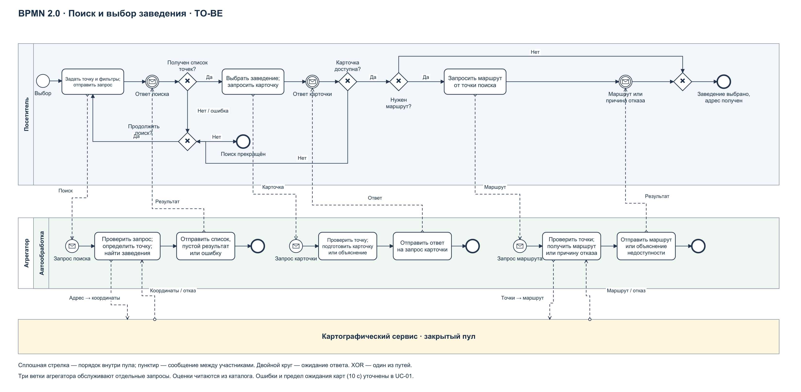

# Итерация 2. Ключевой бизнес-процесс TO-BE

## Поиск и выбор заведения с получением маршрута

Цель процесса — помочь посетителю выбрать действующую точку с шавермой рядом с заданным местоположением на основе сопоставимых сведений об оценках. Начало: возникла потребность выбрать заведение. Успешное завершение: заведение выбрано, адрес получен; при запросе маршрута получен маршрут либо объяснение его недоступности. Альтернативное завершение: пользователь прекратил поиск, когда подходящих точек нет.

Процесс основан на пользовательском файле sec(2).drawio. Исходник сохранён в корне без изменений. Уточнённая модель находится в diagrams/02_search_process.drawio и diagrams/02_search_process.bpmn; PDF и PNG с тем же именем предназначены для просмотра.

## Участники и границы

| Участник | Ответственность |
| --- | --- |
| Посетитель | Задаёт точку и фильтры, принимает результат, уточняет запрос или выбирает заведение, при необходимости запрашивает маршрут |
| Агрегатор | Проверяет запрос, определяет координаты, ищет точки, возвращает оценки и карточку, организует получение маршрута |
| Картографический сервис | Определяет координаты по адресу и рассчитывает маршрут; показан закрытым пулом, внутренние процессы провайдера не моделируются |

Каждый запрос поиска, карточки или маршрута обслуживается отдельным экземпляром соответствующей ветки процесса агрегатора. В модели три стартовых события-сообщения; это не три последовательных этапа одного серверного экземпляра. Посетитель координирует сквозной процесс. Сообщения соотносятся по идентификатору запроса и выбранного заведения; технический протокол не задаётся.

## Ход процесса

1. Посетитель задаёт местоположение и фильтры, затем передаёт запрос агрегатору.
2. Агрегатор проверяет радиус и параметры, определяет точку поиска; при адресном вводе обращается к картографическому сервису. При ошибке возвращает объяснение и запрос исправления. Корректный запрос обрабатывается по RULE-01–04.
3. Агрегатор отправляет результат: найденные точки с расстояниями и доступными внешними оценками либо явное отсутствие результатов. Технические ошибки возвращаются отдельно от пустой выдачи.
4. Посетитель ожидает ответ в промежуточном событии-сообщении. Если результатов нет или требуется исправление, он уточняет запрос и повторяет поиск либо завершает его.
5. При наличии подходящей точки посетитель выбирает её и запрашивает карточку. Агрегатор возвращает адрес, статус и оценки с происхождением. Если точка перестала быть доступной, посетитель возвращается к поиску.
6. Посетитель может закончить выбор, получив адрес. Если нужен маршрут, он передаёт отдельный запрос. Агрегатор проверяет координаты, обращается к картографическому сервису и возвращает маршрут либо причину недоступности. Ожидание ответа посетителем показано промежуточным событием.
7. После получения результата маршрута процесс завершается выбором заведения; недоступность маршрута не аннулирует выбранную карточку и адрес.

## Нотация и уточнения модели

Использованы отдельные пулы посетителя, агрегатора и поставщика карт. Внутри пула агрегатора находится дорожка автоматической обработки «Автообработка». Сплошные потоки последовательности соединяют элементы только внутри одного пула. Пунктирные потоки сообщений соединяют участников. XOR-шлюзы имеют подписанные альтернативы; ожидание результатов показано двойным кругом с конвертом, а стартовые события агрегатора — кругом с конвертом. Роль исполнителя задачи определяется пулом; в BPMN-исходнике дополнительно указаны типы пользовательских и автоматических задач.

Бизнес-процесс не описывает REST-вызовы, кэши и отдельные микросервисы. Источники оценок обновляются отдельной функцией каталога (UC-09); поиск читает уже сохранённые оценки. Это устраняет зависимость каждого пользовательского поиска от одновременной доступности нескольких площадок.

Для читаемости автоматическая обработка ошибок поиска и карточки свёрнута в задачу формирования ответа: успешный результат, отсутствие данных и ошибка различаются содержимым сообщения. Подробные реакции приведены в UC-01 и FR-01–17. Геокодирование и маршрутизация выполняются с конечным ожиданием: при отсутствии ответа в течение 10 секунд агрегатор формирует ответ о недоступности, поэтому посетитель не остаётся в бесконечном ожидании. Этот предел — согласуемое правило пилота.

## Соответствие модели сценариям

| Элемент процесса | Сценарий | Требования |
| --- | --- | --- |
| Отправить запрос; определить точку и найти точки | UC-01, шаги 1–4 | FR-01–08 |
| Получить результат; уточнить или прекратить поиск | UC-01, альтернативы 2.a, 3.a, 4.a | FR-03, FR-09, FR-15–17 |
| Выбрать заведение и получить карточку | UC-01, шаги 5–6; UC-02 | FR-10–12 |
| Запросить и получить маршрут | UC-01, альтернатива 6.a; UC-06 | FR-13–14, FR-17 |
