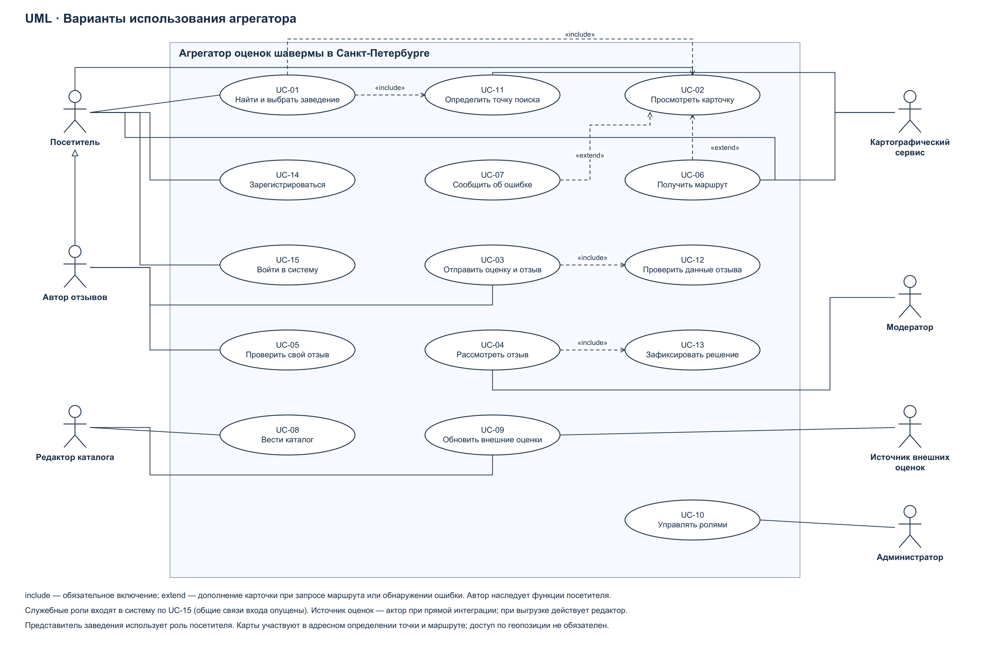

# Итерация 3. Функциональные требования и сценарии

## Акторы и варианты использования

Актор — роль, непосредственно взаимодействующая с агрегатором. Это не полный список заинтересованных сторон: преподаватель, сотрудники заведений, аналитик, хостинг и разработчик заинтересованы в проекте, но отдельные пользовательские функции для них не вводятся.

| Актор | Связь со стейкхолдерами | Доступные цели |
| --- | --- | --- |
| Посетитель | ST-11 | Поиск, карточка, маршрут, сообщение об ошибке, регистрация и вход |
| Автор отзывов | ST-12; специализация посетителя | Отправка собственного отзыва и просмотр его состояния; функции посетителя наследуются |
| Модератор | ST-07 | Рассмотрение заявок и фиксация решений |
| Редактор каталога | ST-08 | Ведение карточек и обновление внешних оценок |
| Администратор | ST-06 | Назначение служебных ролей |
| Картографический сервис | ST-16 | Определение координат по адресу и расчёт маршрута |
| Источник внешних оценок | ST-15 | Передача внешних оценок при прямой интеграции |

Представитель заведения (ST-13) пользуется ролью посетителя, чтобы сообщить об ошибке. Поддержка (ST-09) передаёт обращения редактору или модератору; отдельный модуль поддержки в границы пилота не включён. Владелец продукта согласует правила вне пользовательского интерфейса.

| ID | Вариант использования | Основной участник | Результат |
| --- | --- | --- | --- |
| UC-01 | Найти и выбрать заведение | Посетитель | Выбрана точка и получена её карточка |
| UC-02 | Просмотреть карточку заведения | Посетитель | Получены адрес, статус, оценки источников и опубликованные отзывы |
| UC-03 | Отправить оценку и отзыв | Автор | Создана заявка PENDING, выдан её идентификатор |
| UC-04 | Рассмотреть отзыв | Модератор | Заявка опубликована либо отклонена с причиной |
| UC-05 | Проверить состояние своего отзыва | Автор | Получены собственные заявки, их состояния и причины отклонения |
| UC-06 | Получить маршрут | Посетитель; карты | Получен маршрут к выбранной точке либо причина недоступности |
| UC-07 | Сообщить об ошибке карточки | Посетитель | Зарегистрировано обращение с идентификатором точки и описанием |
| UC-08 | Вести каталог заведений | Редактор | Карточка добавлена или исправлена после проверки сведений |
| UC-09 | Обновить внешние оценки | Редактор; источник | Сохранена проверенная выгрузка или ответ источника с датой и происхождением |
| UC-10 | Управлять служебными ролями | Администратор | Назначены или отозваны роли модератора и редактора |
| UC-11 | Определить точку поиска | Посетитель; карты | Получены координаты из ручного ввода, геопозиции или адреса |
| UC-12 | Проверить данные отзыва | Включаемый сценарий UC-03 | Проверены оценка, длина, существование точки и допустимость повторной заявки |
| UC-13 | Зафиксировать решение модерации | Включаемый сценарий UC-04 | Согласованно сохранены решение, состояние и собственный рейтинг |
| UC-14 | Зарегистрироваться | Посетитель | Создана личная учётная запись |
| UC-15 | Войти в систему | Посетитель и сотрудники | Установлена личность и применены назначенные права |

## Семантика связей UML

UC-01 включает (include) UC-11 и UC-02: успешный выбор требует определения точки и получения карточки. UC-03 включает UC-12; UC-04 включает UC-13. Стрелка include направлена от основного варианта к включаемому.

UC-06 расширяет (extend) UC-02 в точке «карточка получена» при условии, что посетитель запросил маршрут. UC-07 расширяет UC-02 в той же точке при обнаружении неточности. Стрелка extend направлена от дополнительного варианта к расширяемому. Маршрут и обращение не обязательны для просмотра карточки. Эти отношения не изображают хронологический порядок вызовов.

## UC-01. Найти и выбрать заведение

Описание: сократить самостоятельное сопоставление нескольких площадок, помогая выбрать действующую точку в заданном радиусе. Связанные цели: BR-01, BR-02. Приоритет: высокий.

Акторы: посетитель; картографический сервис при адресном вводе или запросе маршрута. Триггер: посетитель хочет найти шаверму рядом с заданной точкой.

Предусловия: каталог доступен; посетителю разрешён анонимный просмотр. Наличие геопозиции и вход в учётную запись не требуются. Наличие подходящих точек не является предусловием.

| Шаг | Действие |
| --- | --- |
| 1 | Посетитель задаёт точку поиска координатами и радиус; при необходимости указывает источник и минимальную оценку. |
| 2 | Система проверяет значения и определяет точку поиска по RULE-02. |
| 3 | Система отбирает действующие заведения Санкт-Петербурга в пределах радиуса и применяет фильтр по RULE-04. |
| 4 | Система предоставляет список, упорядоченный по расстоянию, с названиями, адресами, расстояниями и доступными оценками источников. |
| 5 | Посетитель выбирает заведение и запрашивает сведения о нём. |
| 6 | Система проверяет доступность точки и предоставляет карточку: адрес, статус, координаты, внешние оценки с происхождением, собственный рейтинг и опубликованные отзывы. |
| 7 | Посетитель получает сведения и завершает выбор заведения. |

Альтернативные сценарии:

| Номер | Условие и действия |
| --- | --- |
| 1.a.1 | Вместо координат посетитель задаёт адрес; система запрашивает координаты у картографического сервиса. При однозначном ответе продолжение с шага 2. |
| 1.b.1 | Посетитель разрешает получение геопозиции; система использует полученные координаты и продолжает шаг 2. При отказе или отсутствии координат предлагает ручной ввод; продолжение с шага 1. |
| 2.a.1 | Значение радиуса или фильтра недопустимо: система указывает ошибочное поле и допустимый диапазон. Посетитель исправляет параметры; возврат к шагу 1. |
| 2.b.1 | Адрес не найден или неоднозначен: система сообщает об этом; посетитель уточняет адрес или задаёт координаты; возврат к шагу 1. |
| 3.a.1 | Найденных точек нет: система сообщает об отсутствии результатов по запросу. Посетитель меняет точку, радиус или фильтр; возврат к шагу 1. При отказе продолжать сценарий завершается без выбора. |
| 4.a.1 | Посетитель уточняет критерии, не выбирая точку; возврат к шагу 1. |
| 6.a.1 | После получения карточки посетитель запрашивает маршрут. Система передаёт исходную точку и координаты заведения картографическому сервису. |
| 6.a.2 | Система предоставляет полученный маршрут; продолжение с шага 7. Если маршрут не найден, система сообщает об этом и сохраняет доступ к адресу; продолжение с шага 7 без маршрута. |
| 6.b.1 | Карточка удалена либо точка закрылась после выдачи: система сообщает об изменении; посетитель возвращается к поиску с прежними параметрами, шаг 3. |
| 6.c.1 | В карточке нет собственных оценок либо отсутствуют сведения одного источника: система явно отмечает отсутствие соответствующих данных и показывает остальные; продолжение с шага 7. |
| 6.d.1 | Посетитель сообщает об ошибке карточки (UC-07); система сохраняет обращение с описанием и возвращает его ID. Возврат к шагу 6. |

Ошибки и отсутствие данных:

| Код | Ситуация | Реакция системы |
| --- | --- | --- |
| E1 | Недопустимые координаты или пустое местоположение | Запрос не выполняется; указаны допустимые координаты и необходимость задания точки. Возврат к шагу 1. |
| E2 | Картографический сервис недоступен или не ответил за 10 секунд при геокодировании | Указана недоступность определения адреса; предложены координаты. Возврат к шагу 1. |
| E3 | Каталог недоступен при поиске или получении карточки | Выдана техническая ошибка и возможность повторить запрос с теми же параметрами; пустая выдача не имитируется. Успешный выбор не фиксируется. |
| E4 | Ошибка или ожидание более 10 секунд при построении маршрута | Указана недоступность маршрута; адрес и карточка сохраняются. Продолжение с шага 7. |

Постусловия успеха: карточка выбранного заведения предоставлена; при успешном дополнительном запросе маршрут предоставлен. Данные каталога не изменены. При прекращении поиска выбор не выполнен; при ошибке технический результат не представлен как успешный.

## UC-03. Отправить оценку и отзыв

Описание: получить собственный пользовательский опыт для каталога без немедленной публикации непроверенного содержания. Связанные цели: BR-04 и доверие к сведениям. Приоритет: высокий.

Акторы: автор отзывов. Триггер: автор хочет оценить посещённое заведение.

Предусловия: автор вошёл в систему; идентификатор заведения известен. Допустимость точки и наличие предыдущей заявки проверяются внутри сценария, а не предполагаются.

| Шаг | Действие |
| --- | --- |
| 1 | Автор передаёт идентификатор заведения, целую оценку от 1 до 5 и текст отзыва. Каждой попытке назначен идентификатор запроса. |
| 2 | Система проверяет личность автора и наличие действующей точки в каталоге. |
| 3 | Система проверяет оценку, длину текста и отсутствие другой заявки PENDING или PUBLISHED для той же пары «автор–заведение». |
| 4 | Система сохраняет новую заявку с автором, точкой, оценкой, текстом, временем и состоянием PENDING; заявка включена в очередь модерации. |
| 5 | Система сообщает автору идентификатор заявки, состояние PENDING и необходимость модерации. |
| 6 | Автор получает подтверждение приёма. |

Альтернативные сценарии:

| Номер | Условие и действия |
| --- | --- |
| 2.a.1 | Сеанс истёк: система требует повторного входа. После успешного входа автор повторно отправляет данные; возврат к шагу 1. Без входа заявка не создаётся. |
| 2.b.1 | Точка удалена или не действует: система отказывает в приёме; сценарий завершён без новой заявки. |
| 3.a.1 | Оценка или текст не соответствуют RULE-05: система указывает конкретные нарушения. Автор исправляет данные; возврат к шагу 1. |
| 3.b.1 | Уже есть PENDING или PUBLISHED: система отказывает в создании второй заявки и предоставляет ID и состояние существующей собственной заявки. Сценарий завершён без новой заявки. |
| 3.c.1 | Предыдущая заявка отклонена: при соблюдении остальных правил система принимает новую заявку; продолжение с шага 4. Старая заявка сохраняется в истории. |
| 4.a.1 | Повторён уже выполненный запрос с тем же идентификатором и теми же данными: система возвращает результат первой обработки без создания новой заявки. Переход к шагу 5. |
| 4.b.1 | Две попытки одного автора поступили одновременно с разными идентификаторами: сохраняется одна активная заявка, другая обрабатывается по 3.b.1. |

Ошибки:

| Код | Ситуация | Реакция системы |
| --- | --- | --- |
| E1 | Ошибка сохранения | Новая заявка не подтверждается; выдана техническая ошибка и возможность повтора с тем же идентификатором. Публичный рейтинг не меняется. |
| E2 | Подтверждение потерялось после сохранения | Автор может повторить запрос с тем же идентификатором или проверить свои заявки (UC-05). Повтор не создаёт дубликат. |
| E3 | Для уже обработанного идентификатора переданы другие данные | Система сообщает о конфликте идентификатора; данные ранее принятой заявки не изменяются. Для новой попытки нужен новый идентификатор. |

Постусловия успеха: ровно одна новая заявка сохранена в PENDING, доступна автору и модератору; в публичной карточке отсутствует и в собственном рейтинге не учтена. При ошибке новые данные не подтверждены; повтор ранее успешного запроса возвращает прежнюю заявку.

## UC-04. Рассмотреть отзыв

Описание: опубликовать допустимый отзыв или обоснованно отклонить его, сохранив согласованность собственного рейтинга. Связанная цель: BR-04. Приоритет: высокий.

Акторы: модератор; автор как получатель результата через UC-05. Триггер: модератор обращается к очереди PENDING.

Предусловия: модератор вошёл в систему и имеет действующую служебную роль. Наличие заявок не является предусловием.

| Шаг | Действие |
| --- | --- |
| 1 | Модератор запрашивает очередь ожидающих рассмотрения заявок. |
| 2 | Система возвращает заявки PENDING; модератор выбирает одну. |
| 3 | Система предоставляет текст, оценку, заведение, автора, время и текущее состояние заявки. |
| 4 | Модератор проверяет содержание по RULE-07 и передаёт решение PUBLISHED. |
| 5 | Система повторно проверяет права и состояние PENDING, затем согласованно сохраняет решение, переводит заявку в PUBLISHED и пересчитывает собственный рейтинг точки. |
| 6 | Система подтверждает решение модератору; опубликованный отзыв доступен посетителям, а его состояние — автору. |

Альтернативные сценарии:

| Номер | Условие и действия |
| --- | --- |
| 2.a.1 | Очередь пуста: система сообщает об отсутствии PENDING; сценарий завершён без изменений. |
| 4.a.1 | Модератор выбирает REJECTED и передаёт причину. Система проверяет непустую причину и на шаге 5 фиксирует REJECTED без изменения собственного рейтинга; продолжение с шага 6. |
| 4.b.1 | Модератор передал REJECTED без причины: система отказывает в применении решения и запрашивает причину. Возврат к шагу 4. |
| 4.c.1 | Модератор отказывается завершать рассмотрение: состояние остаётся PENDING; возврат к очереди, шаг 1. |
| 5.a.1 | Заявку уже рассмотрел другой модератор: система не изменяет решение и показывает актуальное состояние; возврат к очереди. |
| 5.b.1 | Повторено ранее зафиксированное решение тем же запросом: система возвращает сохранённый результат без повторного пересчёта или записи второго решения. |
| 5.c.1 | До фиксации решения заведение стало недействующим: система отказывает в публикации, оставляя PENDING; модератор может отклонить заявку с соответствующей причиной. Возврат к шагу 4. |

Ошибки:

| Код | Ситуация | Реакция системы |
| --- | --- | --- |
| E1 | Сеанс истёк либо роль отозвана | Доступ к решению запрещён, данные не изменены. При восстановлении доступа выполняется новое чтение состояния. |
| E2 | Сбой сохранения или пересчёта | Решение, состояние и рейтинг не подтверждаются; заявка остаётся PENDING. Система сообщает об ошибке; возможен повтор с проверкой актуального состояния. |
| E3 | Потерян ответ после успешной фиксации | При повторном запросе система возвращает уже сохранённый результат; дублирование решения и повторный вклад в рейтинг исключены. |

Постусловия успеха: сохранена запись решения; заявка находится в PUBLISHED либо REJECTED; опубликованный отзыв учтён в собственном рейтинге ровно один раз; причина отклонения доступна автору. При отказе или техническом сбое состояние и рейтинг остались прежними.
